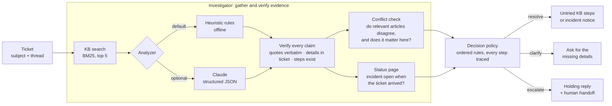

# Lily

Lily is a small support agent. It reads a customer ticket, investigates it
against a knowledge base, the ticket history and a status page, and then does
one of three things:

| Decision | When | The customer gets |
|---|---|---|
| **Resolve** | The knowledge base supports a fix, nothing it needs is missing, and some documented step hasn't been tried yet. Also when a known incident explains the problem. | The steps they haven't tried yet, each traceable to a KB article, or the incident notice |
| **Clarify** | A fix exists but depends on a detail the ticket doesn't contain, or the ticket is too vague to triage | One message asking for exactly the missing details |
| **Escalate** | Policy says a human must handle it, no article covers it, articles conflict in a way that matters, or every documented fix has failed | A holding reply, plus a **handoff** for a human colleague: issue, attempted fixes, evidence checked, open questions |

Every reply is signed by Lily and says it comes from an AI assistant.

Everything is fictional. *Quillstack* is a made-up team-workspace product, and
its 17 knowledge-base articles, status page and 36 tickets were written for this
project. Any resemblance to real products or people is accidental.

> **Status:** first working version, built with Claude Code
> ([how](docs/claude-code-assistance.md)). The results below are **measured** on
> a small fictional dataset; [Limitations](#limitations) explains what they do
> and don't show.

## Quick start (no API key needed)

Python 3.9+ and the standard library only. No install step.

```bash
git clone https://github.com/drriyaa12/lily-support-agent.git
cd lily-support-agent
python3 -m unittest discover -s tests -t .
python3 -m lily run C17
python3 -m lily eval
```

The first command runs the tests, the second prints one ticket's full
transcript, and the third compares Lily with the baseline on the 26 development
cases.

`run` takes a case ID from `eval/cases.json` or `eval/heldout_cases.json`, or a
path to a ticket JSON file. A ticket file has the same shape as a `ticket` in
`eval/cases.json`: `id`, `created_at` (ISO 8601), `customer` (`name`, `plan`),
`channel`, `subject`, and `messages`, a list of
`{"role": "customer" or "agent", "text": "..."}`. Add `--baseline` to see the
baseline's answer, or `--json` for machine-readable output.

## Optional: Claude as the analyzer

The default analyzer is a set of hand-written rules. The Claude analyzer fills
the same report using `claude-opus-5-5` with structured output; everything after
it stays the same. It needs Python 3.10+ and an Anthropic API key.

```bash
python3.12 -m venv .venv && source .venv/bin/activate
pip install -r requirements-claude.txt
cp .env.example .env
set -a; source .env; set +a
python3 -m lily run C25 --analyzer claude
python3 -m lily eval --analyzer claude
python3 -m lily eval --analyzer replay --replay-dir results/claude-dev/raw
```

Put your key in `.env`, which is git-ignored. `set -a; source .env; set +a`
exports it for the current shell. `eval --analyzer claude` writes
`results/claude-dev/`, including every raw model output, and
`--analyzer replay` re-scores those saved outputs without calling the API.

The Anthropic SDK finds the credential itself (`ANTHROPIC_API_KEY`,
`ANTHROPIC_AUTH_TOKEN`, or an `ant auth login` profile). Lily never logs or
stores it. A saved raw output holds the ticket ID, the model and effort, the
stop reason, token counts, the model's JSON and any error message, and never a
credential or request header. A network error, rate limit or server error
that persists after the SDK's own retries is recorded as an analysis error for
that ticket, and the run continues. `SUPPORT_AGENT_MODEL` and
`SUPPORT_AGENT_EFFORT` override the model (default `claude-opus-5-5`) and effort
(default `medium`).

**Claude mode has not been run yet**, so there are no Claude numbers below (see
[Measured vs intended](#measured-vs-intended)).

## Architecture



Lily has two parts that run one after the other. The **investigator** gathers
evidence and checks it. The **decision policy** decides what to do and writes
the reply or handoff. The key design choice: **the analyzer reports facts, and
plain code makes the decision.** Whether the facts come from rules or from
Claude, the investigator drops claims that fail its checks, and a fixed set of
rules decides what the customer is told. That keeps every decision explainable
(each transcript shows the rule trace) and keeps a model mistake from turning
into an invented instruction. The reasoning behind each choice is in
[`docs/design.md`](docs/design.md).

| File | Responsibility |
|---|---|
| `lily/kb.py` | Parse KB articles (front matter, numbered steps, structured facts) |
| `lily/retrieval.py` | BM25 keyword search over the KB |
| `lily/heuristic.py` | Offline analyzer: attempted steps, vagueness, evidence quotes |
| `lily/claude_analyzer.py` | Claude analyzer (structured output), API error handling, replay of saved outputs |
| `lily/investigator.py` | Runs search and analyzer, verifies claims, checks conflicts and the status page |
| `lily/policy.py` | The ordered decision rules and their trace |
| `lily/respond.py` | Customer reply templates, Lily's signature and the human handoff |
| `lily/baseline.py` | The comparison baseline |
| `lily/evaluate.py` | Scoring, metrics and the Markdown report |
| `lily/settings.py` | The decision thresholds, and how they were chosen |

## How a decision is made

The first rule that matches wins. The order mirrors the labelling guide
([`eval/LABELING.md`](eval/LABELING.md)), so Lily and the labels share a
definition of "correct".

| # | Rule | Decision |
|---|---|---|
| 0 | The analysis failed (API error, refusal, unreadable output) | escalate |
| 1 | The best-matching article says "always escalate" (security, privacy) | escalate |
| 2 | The ticket is too vague to pick an article | clarify |
| 3 | No article is relevant | escalate |
| 4 | An incident on that product area was open when the ticket arrived | resolve with the incident notice |
| 5 | Relevant articles disagree in a way that changes this customer's answer | escalate |
| 6 | The article needs details the ticket doesn't contain | clarify |
| 7 | Every step was tried, failed after we suggested it, or is impossible for the customer | escalate |
| 8 | No quote from the article could be verified | escalate |
| 9 | Otherwise | resolve with the untried steps |

## Example runs

Every case has a full transcript in
[`results/heuristic-dev/transcripts/`](results/heuristic-dev/transcripts/) and
[`results/heuristic-heldout/transcripts/`](results/heuristic-heldout/transcripts/).
Each one holds the ticket, investigation log, verified evidence, rule trace,
reply, handoff, and the baseline's answer. Three examples:

**C18, partial fix:** the customer already updated the app and signed out and
back in ([transcript](results/heuristic-dev/transcripts/C18.md)). Lily resolves
with only the two untried steps. The baseline sends all four, including the
two that already failed.

```text
Thanks for already trying these: update to the latest version, sign out and back in. The next steps are:
1. Reset the local cache. Choose Settings → Advanced → Reset local cache. ...
2. Reinstall the app. Uninstall Quillstack, download the latest installer ...

Lily
Quillstack's AI support assistant
```

**C13, conflicting guidance:** a 180 MB upload fails. KB-105 says paid plans
allow 250 MB and the older KB-106 says 100 MB
([transcript](results/heuristic-dev/transcripts/C13.md)). Because 180 MB falls
between the two limits, Lily escalates and doesn't guess. The handoff asks:

```text
Which is right for this customer? On the largest file you can upload on a paid plan, KB-105 says 250
but KB-106 says 100. (The ticket mentions 180 MB, which one article allows and the other does not.)
```

C16 is the counter-case: two refund policies (14 and 30 days) disagree, but the
charge was 3 days ago, which both allow, so Lily resolves.

**C17, every fix failed:** Lily escalates with a handoff listing the four
attempted steps, the evidence checked, the open question, and the KB's own next
step, "ask the customer to attach the sync log"
([transcript](results/heuristic-dev/transcripts/C17.md)).

## Evaluation

**Development cases (26)** in [`eval/cases.json`](eval/cases.json), each with
the expected decision, reason, sources, missing details and attempted steps:

| Category | Cases | Expected |
|---|---|---|
| Routine | 7 | resolve |
| Missing information (including one too-vague ticket) | 5 | clarify |
| Conflicting guidance (one where the conflict doesn't matter) | 4 | 3 escalate, 1 resolve |
| Failed fixes (one with untried steps left) | 5 | 4 escalate, 1 resolve |
| Policy escalation (security, privacy) | 2 | escalate |
| No KB coverage | 2 | escalate |
| Known incident | 1 | resolve |

**Held-out cases (10)** in [`eval/heldout_cases.json`](eval/heldout_cases.json)
were written by a separate agent that saw only the knowledge base, the status
page and the labelling guide, never the code. Before Lily ran on them, three
more agents re-derived every label independently and agreed with all ten. They
were never used for tuning (details in
[`docs/claude-code-assistance.md`](docs/claude-code-assistance.md)).

**Baseline.** A naive "top article" responder using the same KB search and
threshold: if the best match clears the threshold, it sends every step of that
article; otherwise it escalates. It never asks a question, and it ignores the
ticket history, the status page, conflicts and escalation policies. Because
retrieval is shared, differences come from the investigation and decision
logic.

**Metrics.** One outcome per case and system. A resolution only counts as
correct if it cites an expected source, doesn't repeat a step the customer
already tried, **and** includes every step they haven't tried. A clarifying
question must ask for exactly the missing details. An analysis error never
counts as a correct decision. A handoff is only complete if it lists every
labelled attempt and invents none. Full definitions are at the bottom of each
`summary.md`.

**Reproduce:**

```bash
python3 -m lily eval
python3 -m lily eval --cases eval/heldout_cases.json
```

The first writes `results/heuristic-dev/`, the second `results/heuristic-heldout/`.

## Results

### Development set (26 cases, used for tuning)

From [`results/heuristic-dev/summary.md`](results/heuristic-dev/summary.md):

| Metric | Lily | Baseline |
|---|---|---|
| Correct decision (resolve / clarify / escalate) | **25/26** | 11/26 |
| Correct resolutions | 10 of 10 | 8 of 10 |
| Incorrect resolutions | 1 | 16 |
| Appropriate escalations | 10 of 11 | 1 of 11 |
| Unnecessary escalations | 0 | 1 |
| Correct clarifying questions | 5 of 5 | 0 of 5 |
| Resolutions that repeated a step already tried | 0 | 6 |
| Complete handoffs | 10/10 | 2/2 |

The one miss is **C25**: a request to re-issue an invoice with a corrected VAT
number. No article covers it, but keyword search matches the refund article on
"invoice" and Lily sends refund steps.

These numbers are optimistic: the thresholds were tuned on these cases, and the
same assistant wrote the cases and Lily.

### Held-out set (10 cases, never used for tuning)

From [`results/heuristic-heldout/summary.md`](results/heuristic-heldout/summary.md).
The first run used the code as committed in `90af606`
([kept here](results/heldout-first-run/NOTE.md)). That this code was written
before the held-out cases is our account; the git history can't show it. The
first round of review fixes changed no held-out decision (checked case by case).
The second round changed one outcome, H01, explained below.

| Metric | Lily | Baseline |
|---|---|---|
| Correct decision | **6/10** | 3/10 |
| Correct resolutions | 2 of 3 | 1 of 3 |
| Incorrect resolutions | 3 | 8 |
| Appropriate escalations | 2 of 5 | 0 of 5 |
| Unnecessary escalations | 1 | 1 |
| Missed escalations (asked instead of escalating) | 1 | 0 |
| Correct clarifying questions | 1 of 2 | 0 of 2 |
| Resolutions that repeated a step already tried | 2 | 6 |

**This is the honest number.** Lily drops from 96% on the cases it was tuned
on to 60% on new ones. It still doubles the baseline, but the offline rules
don't generalise well. The four wrong decisions:

- **H05:** a vague ticket (subject: "Problems since office move") was longer than
  the rule's 7-word limit for "too vague", so Lily escalated instead of asking
  what's wrong.
- **H06:** keyword search ranked the "only owners can remove members" article
  second, but below the relevance threshold, so only one of the two conflicting
  articles counted. Even with both, the conflict rule needs the ticket to mention
  at least two of "remove", "member" and "role", and this ticket only says
  "remove him", so Lily would still have answered from one article.
- **H08:** in a three-message thread, Lily recognised three of the four steps the
  customer had done and sent the fourth (reinstall) again.
- **H10:** a request for VAT details on invoices matched the refund article on
  "invoice" (the C25 failure again), so Lily asked for an invoice number.

And one right decision with a wrong reply:

- **H01:** the customer had already opened billing settings and swapped in a new
  card. Lily recognised the first step but not the second ("swapped in our new
  card" doesn't match "Replace the card"), so its reply asks them to replace the
  card again. Before the second review, a misreading of the word "without" hid
  this, and the reply scored as correct by accident.

All five are limitations of word matching. They are where the Claude analyzer is
meant to help, but that is untested. These held-out cases have now been inspected,
so any future change should be checked against a fresh set.

### Measured vs intended

| Behaviour | Status |
|---|---|
| Resolves when it should (KB steps or an incident notice) | Measured: dev 10/10, held-out 2/3 (H01 re-sends a step) |
| Skips steps already tried; escalates when all have failed | Measured: dev all correct; held-out misses H01 and H08 |
| Asks for missing details instead of guessing | Measured: dev 5/5, held-out 1/2 |
| Escalates on policy, missing coverage and conflicts that matter | Measured: dev 6/7, held-out 1/3 |
| Drops invented quotes, unretrieved articles, details not in the ticket, and attempted steps whose quote isn't in the ticket | Unit-tested (`tests/test_investigator.py`, `tests/test_claude_analyzer.py`) |
| Claude analyzer improves on the offline analyzer | **Intended, not measured** |
| Resists instructions hidden in tickets (prompt injection) | **Intended by design**, not tested with attack tickets. A ticket can't make Lily send text that isn't a template, KB step or status message, but it could still change which of those is chosen. |

## Pre-publish review

Before publishing, a Claude Code workflow ran 50 agents over the repository.
Four reviewers covered correctness, evaluation integrity, Claude API usage and
confidentiality. Skeptic agents tried to refute each finding, with three
skeptics for high-severity ones. Of 41 findings, 27 were confirmed and 14
refuted. All 27 were addressed (two only partly), and every code fix has a
regression test. The most serious: phrases like "I need to…" were read as "I
already tried…", so Lily could skip a step and thank the customer for it. Other
fixes made the scoring stricter (above) and corrected one development label
(C22). These fixes changed no measured decision.

A second workflow of 40 agents then re-checked the finished repository. It
compared every docs claim with the results, reproduced everything from a fresh
copy, reviewed the fixes for new bugs and re-checked confidentiality. It
confirmed 27 more findings and refuted 5. The confirmed ones include a regression
the first fixes had introduced (a question mark hid reported attempts) and the
H01 misreading above. They were fixed the same way, except one that needs the
repository owner (a personal email address in one GitHub merge commit). Details
are in [`docs/claude-code-assistance.md`](docs/claude-code-assistance.md).

## Limitations

- **Tiny, self-made dataset.** 36 fictional tickets written by AI agents, 26 of
  them by the same assistant that wrote Lily. The development set was used for
  tuning.
- **Keyword retrieval.** BM25 matches words, not meaning (C25, H10). A conflict
  can only be detected between articles that clear the relevance threshold, and
  only when the ticket mentions what the conflict is about (H06). The threshold
  was tuned on the development set.
- **Brittle offline analyzer.** Attempted steps are detected with phrase rules
  ("I already…", "I've updated…", "I don't have…"), and "too vague" is a word
  count. Paraphrases and long-but-vague tickets are missed (H01, H05, H08).
- **Offline summaries are extracts.** Without Claude, the "summary" is the
  customer's first sentences and the "core issue" is the subject plus the
  closest article's title.
- **Conflict detection needs structured facts** in the article front matter.
  Real KBs rarely have them. Claude mode also reports contradictions in prose.
  Role-specific facts aren't scoped: an owner asking about removing members still
  escalates, even though both articles allow owners to do it.
- **Only the best-matching article's policy is applied.** A security article
  ranked second does not force an escalation.
- **No real systems.** Lily can't look up accounts, issue refunds or read logs.
  It can only cite the KB and the status page. Incidents match on product area
  and time only.
- **Plain replies.** Replies are templates filled with KB text: accurate but not
  warm, and English only.

## Project layout

```text
lily/                         Lily (standard library only; claude_analyzer.py uses the anthropic SDK)
tests/                        unit and integration tests
data/kb/                      17 fictional KB articles (Markdown + front matter)
data/status.json              fictional status page
eval/                         development cases, held-out cases, labelling guide
results/heuristic-dev/        report, metrics and transcripts: development set
results/heuristic-heldout/    the same for the held-out set
results/heldout-first-run/    the first held-out run, before the review fixes
docs/                         design notes, how Claude Code was used
```

## How this was built

Built with Claude Code from a written brief. It wrote the code, the fictional
data and the development labels, ran the tests and the evaluations, and
reviewed every transcript. Separate agents wrote and audited the held-out cases
and reviewed the code before publishing. What was and wasn't verified is listed in
[`docs/claude-code-assistance.md`](docs/claude-code-assistance.md).

## License

[MIT](LICENSE). Copyright (c) 2026 drriyaa12. This covers the code and the fictional data (knowledge base, tickets and status page).
