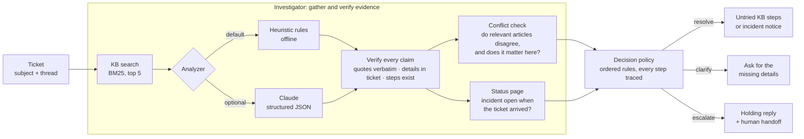

# Support triage agent

A small support agent that reads a customer ticket, investigates it against a
knowledge base, the ticket history and a status page, and then does one of
three things:

| Decision | When | The customer gets |
|---|---|---|
| **Resolve** | The knowledge base supports a fix, nothing it needs is missing, and some documented step hasn't been tried yet. Also when a known incident explains the problem. | The steps they haven't tried yet, each traceable to a KB article, or the incident notice |
| **Clarify** | A fix exists but depends on a detail the ticket doesn't contain, or the ticket is too vague to triage | One message asking for exactly the missing details |
| **Escalate** | Policy says a human must handle it, no article covers it, articles conflict in a way that matters, or every documented fix has failed | A holding reply, plus a **handoff** for the human: issue, attempted fixes, evidence checked, open questions |

Everything is fictional. *Quillstack* is a made-up team-workspace product, and
its 17 knowledge-base articles, status page and 36 tickets were written for
this project. Any resemblance to real products or people is accidental.

> **Status:** first working version, built with Claude Code
> ([how](docs/claude-code-assistance.md)). Results below are **measured** on a
> small fictional dataset; [Limitations](#limitations) explains what they do
> and do not show.

## Quick start (no API key needed)

Python 3.9+ and the standard library only. No install step.

```bash
git clone <this repository's URL> support-triage-agent
cd support-triage-agent
python3 -m unittest discover -s tests -t .    # 94 tests
python3 -m triage run C17                     # one ticket, full transcript
python3 -m triage eval                        # agent vs baseline on all 26 dev cases
```

`run` takes a case ID from `eval/cases.json` or a path to a ticket JSON file.
Add `--baseline` to see the baseline's answer, or `--json` for machine-readable
output.

## Optional: Claude as the analyzer

The offline analyzer uses hand-written rules. The Claude analyzer fills the same
report using `claude-opus-5-5` with structured output; everything downstream
stays the same. It needs Python 3.10+ and an Anthropic API key.

```bash
python3.12 -m venv .venv && source .venv/bin/activate
pip install -r requirements-claude.txt
cp .env.example .env              # put your key in .env (git-ignored)
set -a; source .env; set +a       # exports ANTHROPIC_API_KEY for this shell

python3 -m triage run C25 --analyzer claude
python3 -m triage eval --analyzer claude      # saves every raw model output to results/claude/raw/
python3 -m triage eval --analyzer replay --replay-dir results/claude/raw   # re-score saved outputs, no API calls
```

Credentials are only read from the environment by the Anthropic SDK. They are
never written to files, logs or results. `SUPPORT_AGENT_MODEL` and
`SUPPORT_AGENT_EFFORT` override the model (default `claude-opus-5-5`) and effort
(default `medium`). **Claude mode has not been run yet**, so there are no Claude
numbers below (see [Measured vs intended](#measured-vs-intended)).

## Architecture



The key design choice: **the analyzer reports facts, and plain code makes the
decision.** Whether the facts come from rules or from Claude, the investigator
drops anything it can't verify, and a fixed set of rules decides what the
customer is told. That keeps every decision explainable (each transcript shows
the rule trace) and keeps a model mistake from turning into an invented
instruction. The reasoning behind each choice is in
[`docs/design.md`](docs/design.md).

| File | Responsibility |
|---|---|
| `triage/kb.py` | Parse KB articles (front matter, numbered steps, structured facts) |
| `triage/retrieval.py` | BM25 keyword search over the KB |
| `triage/heuristic.py` | Offline analyzer: attempted steps, vagueness, evidence quotes |
| `triage/claude_analyzer.py` | Claude analyzer (structured output) and replay of saved outputs |
| `triage/investigator.py` | Runs search and analyzer, verifies claims, checks conflicts and the status page |
| `triage/policy.py` | The ordered decision rules and their trace |
| `triage/respond.py` | Customer reply templates and the human handoff |
| `triage/baseline.py` | The comparison baseline |
| `triage/evaluate.py` | Scoring, metrics and the Markdown report |
| `triage/settings.py` | Every tunable number, and how it was chosen |

## How a decision is made

The first rule that matches wins. The order mirrors the labelling guide
([`eval/LABELING.md`](eval/LABELING.md)), so the agent and the labels share a
definition of "correct".

| # | Rule | Decision |
|---|---|---|
| 0 | The analysis failed (API refusal, unreadable output) | escalate |
| 1 | The best-matching article says "always escalate" (security, privacy) | escalate |
| 2 | The ticket is too vague to pick an article | clarify |
| 3 | No article is relevant | escalate |
| 4 | An incident on that product area was open when the ticket arrived | resolve with the incident notice |
| 5 | Relevant articles disagree in a way that changes this customer's answer | escalate |
| 6 | The article needs details the ticket doesn't contain | clarify |
| 7 | Every step was tried, failed after we suggested it, or is impossible for the customer | escalate |
| 8 | No quote from the article could be verified | escalate |
| 9 | Otherwise | resolve with the untried steps |

## Example runs

Every case has a full transcript (ticket, investigation log, verified evidence,
rule trace, reply, handoff, and the baseline's answer) in
[`results/heuristic/transcripts/`](results/heuristic/transcripts/). Three
examples:

**C18, partial fix:** the customer already updated the app and signed out and
back in ([transcript](results/heuristic/transcripts/C18.md)). The agent
resolves with only the two untried steps. The baseline sends all four,
including the two that already failed.

```text
Thanks for already trying these: update to the latest version, sign out and back in. The next steps are:
1. Reset the local cache. Choose Settings → Advanced → Reset local cache. ...
2. Reinstall the app. Uninstall Quillstack, download the latest installer ...
```

**C13, conflicting guidance:** a 180 MB upload fails. KB-105 says paid plans
allow 250 MB and the older KB-106 says 100 MB
([transcript](results/heuristic/transcripts/C13.md)). Because 180 MB falls
between the two limits, the agent escalates and doesn't guess. The handoff asks:

```text
Which is right for this customer? On the largest file you can upload on a paid plan, KB-105 says 250
but KB-106 says 100. (The ticket mentions 180 MB, which one article allows and the other does not.)
```

C16 is the counter-case: two refund policies (14 and 30 days) disagree, but the
charge was 3 days ago, which both allow, so the agent resolves.

**C17, every fix failed:** the agent escalates with a handoff listing the four
attempted steps, the evidence checked, the open question, and the KB's own next
step, "ask the customer to attach the sync log"
([transcript](results/heuristic/transcripts/C17.md)).

## Evaluation

**Cases.** 26 development cases in [`eval/cases.json`](eval/cases.json), each
with the expected decision, reason, sources, missing details and attempted steps:

| Category | Cases | Expected |
|---|---|---|
| Routine | 7 | resolve |
| Missing information (including one too-vague ticket) | 5 | clarify |
| Conflicting guidance (one where the conflict doesn't matter) | 4 | 3 escalate, 1 resolve |
| Failed fixes (one with untried steps left) | 5 | 4 escalate, 1 resolve |
| Policy escalation (security, privacy) | 2 | escalate |
| No KB coverage | 2 | escalate |
| Known incident | 1 | resolve |

Plus 10 **held-out** cases in [`eval/heldout_cases.json`](eval/heldout_cases.json),
written separately and never used for tuning (see
[how](docs/claude-code-assistance.md#how-the-evaluation-data-was-produced)).

**Baseline.** A naive "top article" responder using the same KB search and
threshold: if the best match clears the threshold, it sends every step of that
article; otherwise it escalates. It never asks a question, and it ignores the
ticket history, the status page, conflicts and escalation policies. Because
retrieval is shared, differences come from the investigation and decision
logic.

**Metrics.** One outcome per case and system: correct or incorrect
resolution, appropriate or unnecessary escalation, missed escalation, and
correct, incorrect or unnecessary clarification. A resolution only counts as
correct if it cites an expected source **and** doesn't repeat a step the
customer already tried. An analyzer failure is counted separately, never as a
good escalation. Full definitions are at the bottom of each `summary.md`.

**Reproduce:**

```bash
python3 -m triage eval                                                            # → results/heuristic/
python3 -m triage eval --cases eval/heldout_cases.json --out results/heuristic-heldout
```

## Results

### Measured: offline analyzer, development set (26 cases)

From [`results/heuristic/summary.md`](results/heuristic/summary.md):

| Metric | Agent | Baseline |
|---|---|---|
| Correct decision (resolve / clarify / escalate) | **25/26** | 11/26 |
| Correct resolutions | 10 of 10 | 8 of 10 |
| Incorrect resolutions | 1 | 16 |
| Appropriate escalations | 10 of 11 | 1 of 11 |
| Unnecessary escalations | 0 | 1 |
| Correct clarifying questions | 5 of 5 | 0 of 5 |
| Resolutions that repeated a step already tried | 0 | 5 |
| Complete handoffs | 10/10 | 2/2 |

The one miss is **C25**: a request to re-issue an invoice with a corrected VAT
number. No article covers it, but keyword search matches the refund article on
"invoice" and the agent sends refund steps. This is a real weakness of
keyword retrieval, not a labelling quirk.

**Read this with care:** the thresholds were tuned on these 26 cases, and the
same assistant wrote the cases and the agent. This number shows the design
works as intended on the cases it was built for. It is not evidence of how it
does on new tickets.

### Measured: offline analyzer, held-out set (10 cases)

HELDOUT_PLACEHOLDER

### Not measured yet

- **Claude analyzer:** implemented and unit-tested against a fake client, but
  never run against the real API (no key in the build environment). Expected to
  help most where the offline rules are weakest: paraphrased attempts, relevance
  beyond shared keywords (C25), and conflicts stated only in prose. That
  expectation is untested.
- Cost and latency of Claude mode.

### Measured vs intended

| Behaviour | Status |
|---|---|
| Resolves routine tickets with KB steps, citing the article | Measured on dev and held-out sets |
| Skips steps already tried; escalates when all have failed | Measured on dev and held-out sets |
| Asks for missing details instead of guessing | Measured on dev and held-out sets |
| Escalates on policy, missing coverage, conflicts that matter | Measured on dev and held-out sets |
| Drops invented quotes, unretrieved articles, details not in the ticket | Unit-tested (`tests/test_investigator.py`, `tests/test_claude_analyzer.py`) |
| Claude analyzer improves on the offline analyzer | **Intended, not measured** |
| Resists instructions hidden in tickets (prompt injection) | **Intended by design** (replies are templated, claims verified); not tested with attack cases |

## Limitations

- **Tiny, self-made dataset.** 36 fictional tickets written by the same AI
  assistant that wrote the agent. The development set was used for tuning.
  The held-out set reduces but does not remove that bias.
- **Keyword retrieval.** BM25 matches words, not meaning (C25). The threshold
  was tuned on the development set.
- **Brittle offline analyzer.** Attempted steps are detected with phrase rules
  ("I already…", "I've updated…", "I don't have…"). Paraphrases it hasn't seen
  are missed. That's why the Claude analyzer exists.
- **Offline summaries are extracts.** Without Claude, the "summary" is the
  customer's first sentences and the "core issue" is the subject plus the
  closest article's title. Written summaries need the Claude analyzer.
- **Conflict detection needs structured facts** in the article front matter.
  Real KBs rarely have them. Claude mode also reports contradictions in prose.
- **Only the best-matching article's policy is applied.** A security article
  ranked second does not force an escalation.
- **No real systems.** The agent can't look up accounts, issue refunds or read
  logs. It can only cite the KB and the status page. Incidents match on product
  area and time only.
- **Plain replies.** Replies are templates filled with KB text: accurate but not
  warm, and English only.

## Project layout

```text
triage/            the agent (standard library only; claude_analyzer.py uses the anthropic SDK)
tests/             unit and integration tests (python3 -m unittest discover -s tests -t .)
data/kb/           17 fictional KB articles (Markdown + front matter)
data/status.json   fictional status page
eval/              labelled cases, held-out cases, labelling guide
results/           generated reports, metrics and per-case transcripts
docs/              design notes, Claude Code assistance
```

## How this was built

Built with Claude Code from a written brief. It wrote the code, the fictional
data and the labels; ran the tests and the evaluation; and reviewed every
transcript. Three output problems it found that way were fixed. A separate
subagent wrote the held-out cases without access to the code. What was and
wasn't verified is listed in
[`docs/claude-code-assistance.md`](docs/claude-code-assistance.md).
